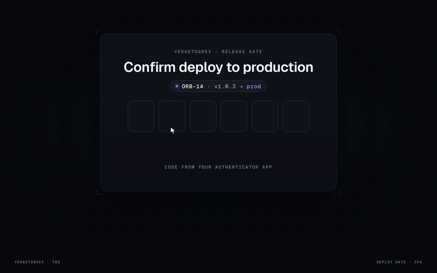

# Stack Seal

**Six digits. One seal.**



**Live demo:** [veraetogrex-portfolio.github.io/stack-seal](https://veraetogrex-portfolio.github.io/stack-seal/) · **Mockup:** [full-screen version](https://veraetogrex-portfolio.github.io/stack-seal/mockup/stack-seal.html)

Confirm a production deploy with a code from an authenticator app. On the 6th digit the cells slide into one stack, squeeze into a square and stamp an Ion seal whose light floods the page. Then a progress line ships the release.

## Use it

Three files, no build step, no dependencies, no web fonts:

```
index.html   markup
style.css    styles and keyframes
script.js    behaviour
```

Download the repo and open `index.html`, or copy the three files into your project.

## Try it

- Focus the first cell: the authenticator hint appears, click it to autofill `482913`.
- Wrong code: the stack doesn't form, the cells shake and show “Code expired”.

## Make it yours

`AUTH_CODE` and `checkCode` are at the top of `script.js`. Replace `checkCode` with a call to your 2FA endpoint. Colours are CSS custom properties at the top of `style.css`.

`prefers-reduced-motion` is respected: heavy motion drops to short fades.

## What's in `mockup/`

The full 1440×900 screen this component was shot in for the reel:

- `mockup/stack-seal.html` — interactive. `D` plays the demo, `R` resets.
- `mockup/stack-seal.autoplay.html` — the scripted ~6 s loop with a drawn cursor.
- URL flags: `?frame` puts the screen in a browser window, `?clean` hides the control panel, `?once` plays the demo once.

The mockup uses a shared stage runtime and bundled fonts from `mockup/_shared/`. The component in the root doesn't need any of it.

---

Component 02 of a series. New one every day on Instagram [@veraetogrex_portfolio](https://www.instagram.com/veraetogrex_portfolio/) · all components: [github.com/veraetogrex-portfolio](https://github.com/veraetogrex-portfolio)

MIT licensed.
